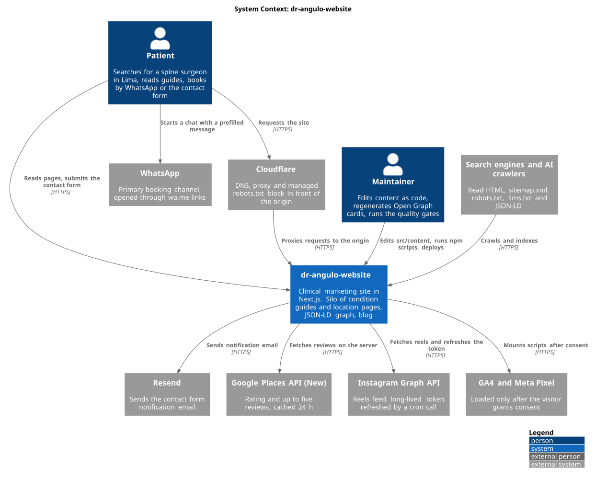
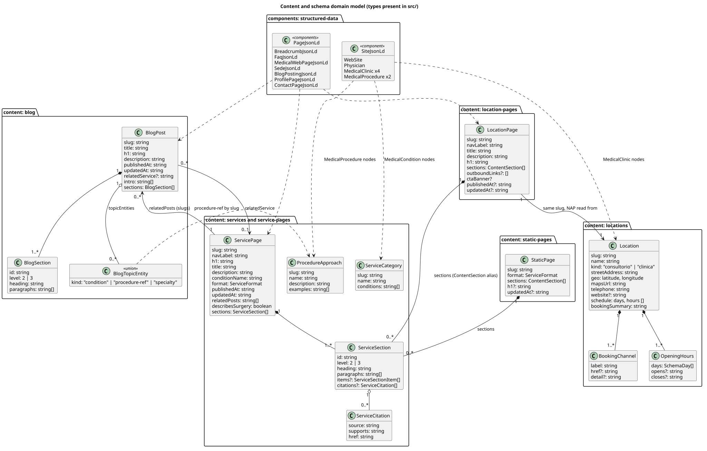
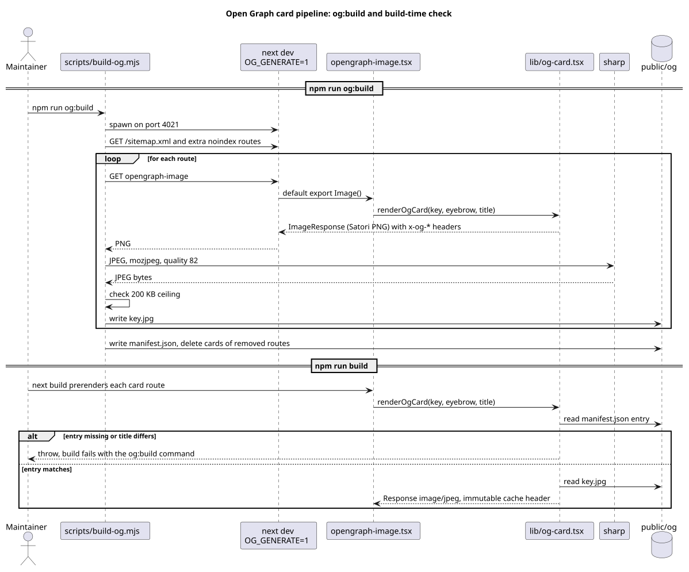
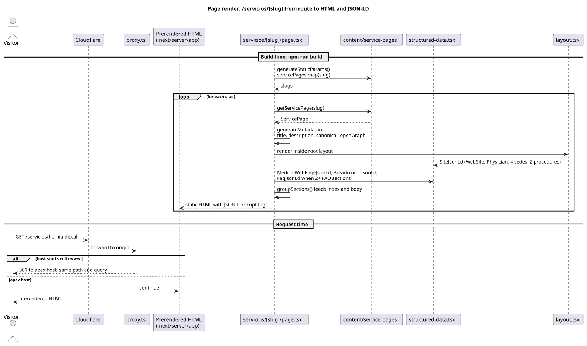
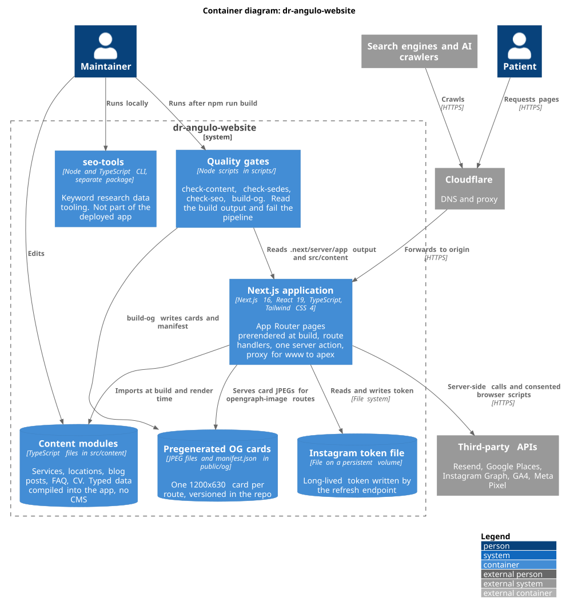
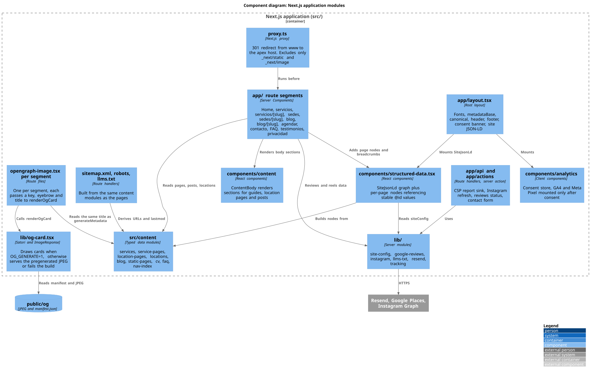

# dr-angulo-website

Website for Dr. Juan Carlos Angulo Totesaut, a trauma and spine surgeon in Lima, Peru. The goal is simple: a patient who searches for a spine surgeon in Lima finds the site, trusts it, and books by WhatsApp in two clicks.

It is built with Next.js 16 and TypeScript. All content lives in typed modules inside the repo, there is no CMS and no database. The site is also a case study in technical SEO for a medical practice: a silo of condition guides and location pages, one Schema.org graph, pre-rendered Open Graph cards, and a set of build-time gates that fail the pipeline when SEO rules break.

The site is in Spanish (`lang="es"`, `inLanguage` `es-PE`). Code comments and planning notes are in Spanish too.



## What is in it

| Feature | Where it lives |
| --- | --- |
| Silo by condition: hub plus one guide per condition | `src/app/servicios/`, `src/content/service-pages/` |
| Silo by location: hub plus one page per clinic | `src/app/sedes/`, `src/content/location-pages/`, `src/content/locations.ts` |
| Blog with posts linked to the guides they feed | `src/app/blog/`, `src/content/blog/` |
| One Schema.org `@graph` with stable `@id` values | `src/components/structured-data.tsx` |
| Pre-rendered Open Graph JPEG per route | `src/lib/og-card.tsx`, `scripts/build-og.mjs`, `public/og/` |
| Sitemap with a browser stylesheet, `robots.txt`, `llms.txt` | `src/app/sitemap.xml/route.ts`, `src/app/robots.ts`, `src/app/llms.txt/route.ts` |
| www to apex 301 redirect | `src/proxy.ts` |
| Consent-gated GA4 and Meta Pixel | `src/components/analytics/` |
| Contact form with honeypot, Zod validation and WhatsApp fallback | `src/app/actions/contact.ts` |
| Security headers and a report-only CSP | `next.config.ts`, `src/app/api/csp-report/route.ts` |
| Build-output gates for content, locations and SEO | `scripts/check-*.mjs` |

## Tech stack

- Next.js 16.2 (App Router), React 19.2, TypeScript 5
- Tailwind CSS 4, `lucide-react`, `clsx`, `tailwind-merge`
- Fonts through `next/font/google`: Poppins and Inter
- Zod for form validation, Resend for email
- `@next/third-parties` for GA4, loaded on demand
- `sharp` and Satori (`next/og`) for Open Graph cards
- ESLint 9 with `eslint-config-next`
- Node 22 (`.node-version`)

## Project structure

```
src/
  app/                  Route segments, one folder per URL
    servicios/[slug]/   Condition guides
    sedes/[slug]/       Location pages
    blog/[slug]/        Posts
    api/                CSP report sink, Instagram token refresh, reviews status
    actions/contact.ts  Contact form server action
    sitemap.xml/        Sitemap as a route handler
    llms.txt/           llms.txt route
    **/opengraph-image.tsx   One card route per segment
  components/
    structured-data.tsx JSON-LD components
    content/            ContentBody and citations
    analytics/          Consent store and tracking scripts
    layout/ ui/ ...     Header, footer, CTAs, cards
  content/              Typed data: services, service-pages, locations,
                        location-pages, blog, static-pages, cv, faq, nav-index
  lib/                  site-config, og-card, google-reviews, instagram,
                        llms-txt, resend, tracking
  proxy.ts              www to apex redirect
scripts/                build-og and the three check-* gates
public/og/              Generated cards and manifest.json
docs/                   Operational notes and docs/architecture diagrams
seo-tools/              Keyword research tooling, separate package
.planning/              GSD planning artifacts: milestones, phases, decisions
audit/                  Dated audit findings and performance baselines
```

## Content model

Content is code. Each page type has a TypeScript type and one data module per entry. One template per type renders it.

- **Guides.** `ServicePage` in `src/content/service-pages/index.ts`. Slug, title, description, H1, `publishedAt`, `updatedAt`, a flat list of `ServiceSection` items (level 2 or 3), optional citations, and `relatedPosts`. The route `src/app/servicios/[slug]/page.tsx` calls `generateStaticParams` over this list.
- **Locations.** `Location` in `src/content/locations.ts` is the single source for name, address, geo, phone, hours and booking channels. `LocationPage` in `src/content/location-pages/` adds the editorial layer. The sitemap and the static params come from `locationPages`, so a location without editorial content has no route.
- **Posts.** `BlogPost` in `src/content/blog/index.ts`. Each post can point to one guide through `relatedService`, and declares what it is about through `topicEntities` (condition, procedure reference or specialty). That field feeds the `about` property of the JSON-LD.
- **Static pages.** `StaticPage` in `src/content/static-pages/` reuses the same section model for home and hubs.
- **Nav index.** `src/content/nav-index.ts` holds a light copy of slugs and labels for the client menu. `assertNavIndexMatches` throws during the build when it drifts from the page modules.



Business rule worth knowing: the doctor's WhatsApp books only the private office. The three clinics manage their own agendas. `scripts/check-sedes.mjs` enforces that clinic pages never offer the doctor's chat.

## SEO and structured data

- **Schema graph.** The root layout emits one `@graph` with `WebSite`, `Physician`, four `MedicalClinic` nodes and two `MedicalProcedure` nodes. Pages add their own nodes (`MedicalWebPage`, `BlogPosting`, `FAQPage`, `ContactPage`, `ProfilePage`, `BreadcrumbList`) and reference the stable `@id` values instead of repeating data. The page-by-page table is in `docs/structured-data.md`.
- **No review markup.** The site shows Google reviews with attribution but never emits `Review` or `AggregateRating`. `scripts/check-seo.mjs` fails if either appears.
- **Canonicals.** Every route sets `alternates.canonical`. `metadataBase` comes from `NEXT_PUBLIC_SITE_URL`.
- **hreflang.** Not present. The site is single language and multi-language is out of scope in `.planning/PROJECT.md`.
- **Sitemap.** `src/app/sitemap.xml/route.ts` serializes `loc` and `lastmod` only, with an XSL stylesheet (`public/sitemap.xsl`) so it reads well in a browser. `/privacidad` is `noindex` and stays out.
- **robots.txt and llms.txt.** `robots.ts` allows crawlers and blocks `/api/`. `llms.txt` is built from the same content modules as the pages, so it cannot drift. Cloudflare prepends its own managed robots block: see `docs/cloudflare-robots.md`.
- **Open Graph.** Every route has its own 1200x630 card. Details below.
- **Gates.** `check-seo.mjs` measures the built HTML: breadcrumbs on nested routes, credentials and hours in the root graph, title and description length, unique OG image per route, `llms.txt` content.

## Open Graph image pipeline

Cards are drawn with Satori from the same title that `generateMetadata` uses, then converted to JPEG with mozjpeg at quality 82 and committed to `public/og/`. In production the route serves the JPEG. The reason is weight: the home PNG was 551 KB, and WhatsApp, the main channel, is slow to build previews from heavy images.

If a title changes and the card does not, `npm run build` fails with the exact command to run. `docs/open-graph-cards.md` has the full procedure.



## Rendering and performance

Pages are prerendered at build with `generateStaticParams`. Home and testimonials use `revalidate = 3600` because they show the Google reviews and Instagram reels feeds.



What the repo does for Core Web Vitals:

- Analytics code is imported on demand and only after consent (`analytics-scripts.tsx`).
- Fonts use `next/font` with `display: swap`.
- Images are AVIF files in `public/`.
- OG cards are small pregenerated JPEGs with immutable cache headers.
- The nav index keeps the content modules out of the client bundle.

Measured numbers live in `audit/baselines/` with their date and tool. The PageSpeed Insights run of 2026-08-25 on the mobile home page recorded performance 0.91, TBT 0 ms, CLS 0 and LCP 3.4 s. Field data was not yet available for the domain at that time.

## Architecture diagrams

PlantUML sources and rendered SVGs live in `docs/architecture/`.





To re-render after editing a `.puml` file:

```bash
plantuml -tsvg -o . docs/architecture/*.puml
```

## Local development

```bash
npm install
npm run dev        # http://localhost:3000
npm run build
npm run start
npm run lint
```

## Environment variables

Names only. Copy `.env.example` to `.env.local` and fill in values. Nothing is required to run the site locally.

| Variable | Purpose |
| --- | --- |
| `NEXT_PUBLIC_SITE_URL` | Public origin. Falls back to `https://drangulocolumna.com`. |
| `NEXT_PUBLIC_GA_ID` | GA4 measurement ID. Empty means GA4 does not load. |
| `NEXT_PUBLIC_META_PIXEL_ID` | Meta Pixel ID. Empty means no pixel. |
| `RESEND_API_KEY` | Email delivery. Without it the form still hands off to WhatsApp. |
| `EMAIL_FROM` | Verified sender in Resend. |
| `CONTACT_EMAIL_TO` | Inbox for form submissions. |

The code also reads these, documented in `docs/structured-data.md` and `src/lib/instagram.ts` but not in `.env.example`: `GOOGLE_PLACES_API_KEY`, `GOOGLE_PLACE_ID`, `GOOGLE_REVIEWS_MAX_CALLS_PER_DAY`, `INSTAGRAM_ACCESS_TOKEN`, `INSTAGRAM_TOKEN_FILE`, `CRON_SECRET`, plus `OG_GENERATE` and `OG_PORT`, which only `scripts/build-og.mjs` sets.

## Testing and quality gates

There is no unit test suite in the app. Quality is enforced by gates that read the build output in `.next/server/app/` and fail when it is missing:

```bash
npm run build
npm run content:check   # body length, heading hierarchy, ToC, banner position, links, sitemap
npm run sedes:check     # location pages and the booking-channel rule
npm run seo:check       # JSON-LD, titles, descriptions, OG images, llms.txt
npm run og:build        # regenerate Open Graph cards (starts next dev)
```

`seo-tools/` is a separate package with its own tests (`npm test` inside that folder). It is not part of the deployed app.

## Deployment

Per `.planning/PROJECT.md`, the site runs on a self-hosted Dokploy instance on a Hetzner VPS, with Cloudflare in front for DNS and proxying. The apex domain is canonical and `www` redirects to it through `src/proxy.ts`. The Instagram token is stored on a persistent volume through `INSTAGRAM_TOKEN_FILE`. The repo has no Dockerfile or CI workflow, so the build settings live in Dokploy.

## Design decisions

- **Content as code.** One editor, small site, typed data. Types catch broken links between guides, posts and locations at build time.
- **One source of truth per fact.** Address, hours and phone live in `locations.ts` only. JSON-LD, pages and `llms.txt` all read from it.
- **Gates read the output, not the source.** A gate that passes when its input is missing is worse than no gate, so each one fails if the build is absent.
- **Pregenerated OG cards.** A fixed, small file beats on-demand generation for crawlers and chat apps. The manifest check removes the risk of stale titles.
- **No review markup.** Google forbids marking up third-party reviews on your own site. The reviews are displayed, not declared.
- **Report-only CSP.** The site loads maps, Meta, GA4 and Instagram assets. A wrong enforced policy would break production silently, so it reports first. See `docs/content-security-policy.md`.
- **Medical content rules.** No surgery counts, success rates or prices. Every clinical page carries an educational disclaimer.
